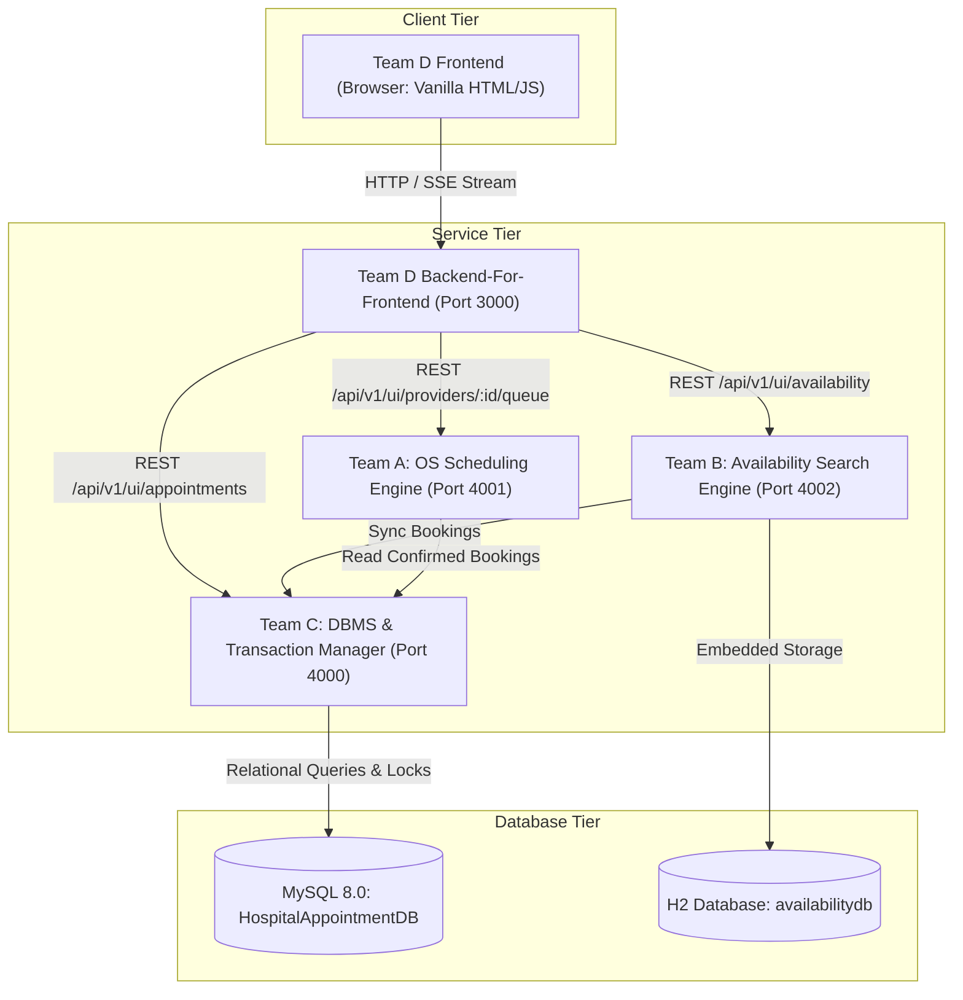
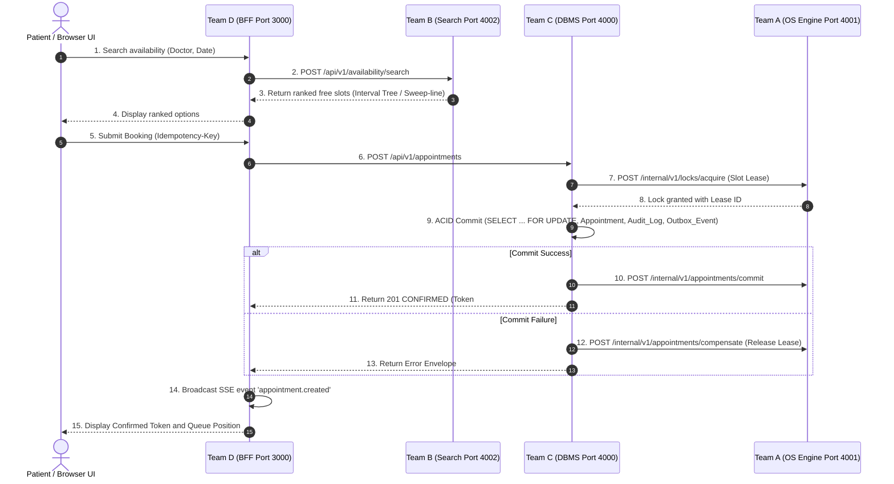

# INTEGRATION REPORT: CareSlot Service Architecture & Cross-Team Contracts

**System:** CareSlot Multi-Provider Appointment Scheduling Engine  
**Date:** October 11, 2026  
**Auditor:** Senior Full-Stack Software Engineer & Software Architect  

---

## 1. Architectural Topology & Service Endpoints

### Active Services Configuration:
| Team | Service Purpose | Host / Port | Environment Keys | Primary Data Store |
| :--- | :--- | :--- | :--- | :--- |
| **Team A** | Booking Queue & OS Scheduler Engine | `http://localhost:4001` | `PORT=4001`, `SERVICE_KEY`, `POLICY=PRIORITY`, `TEAM_C_URL` | In-memory queues (Heap, Circular, FIFO) & Slot Leases |
| **Team B** | Availability Search & Conflict Analytics | `http://localhost:4002` | `PORT=4002`, `SERVICE_KEY`, `TEAM_C_URL`, `TEAM_C_KEY` | Augmented Interval Tree, Slot Cache, H2 DB |
| **Team C** | Database & Transaction Authority | `http://localhost:4000` | `PORT=4000`, `SERVICE_KEY`, `DB_HOST`, `DB_USER`, `DB_NAME` | MySQL 8.0 (`HospitalAppointmentDB`) |
| **Team D** | BFF Gateway & Frontend Dashboard | `http://localhost:3000` | `PORT=3000`, `TEAM_A_URL`, `TEAM_B_URL`, `TEAM_C_URL` | Team C Authoritative Data + local `data/store.json` fallback |

---

## 2. Cross-Team Request Conventions & Traceability

1. **Correlation IDs (`X-Correlation-ID`):**
   - Generated at Team D on incoming HTTP requests or UI interactions.
   - Propagated through Team D -> Team C -> Team A -> Team B.
   - Stored in MySQL `Audit_Log.correlation_id` on every transactional state change.
2. **Idempotency (`Idempotency-Key`):**
   - Mandatory on booking creations (`POST /api/v1/appointments`).
   - Team C checks `uq_appt_idem` in MySQL table `Appointment`.
   - Subsequent calls with identical key return HTTP 201 with header `Idempotent-Replay: true` and the original record.
3. **Response Envelopes:**
   - Success: `{"data": {...}, "meta": {"correlation_id": "...", "api_version": "v1"}}`
   - Error: `{"error": {"code": "...", "message": "...", "details": [...]}, "meta": {"correlation_id": "..."}}`
4. **Authentication & Authorization:**
   - Team D uses Bearer session tokens generated on `POST /api/v1/ui/session` using Scrypt hashing.
   - Inter-service communication uses pre-shared Bearer keys (`TEAM_A_KEY`, `TEAM_B_KEY`, `TEAM_C_KEY`).

---

## 3. End-to-End Execution Sequence Flow

---

## 4. Integration Defects Identified and Remedied

1. **Unreachable Code in Team D Appointment Details (`server.js`):**
   - *Problem:* `route('GET', '/appointments/:id')` returned an object literal on line 1304, causing downstream enrichment logic (Team A queue inspection and Team B conflict check) to be unreachable dead code.
   - *Resolution:* Restructured handler to define `const payload = { ... }`, execute Team A queue lookup and Team B availability check, and return the enriched aggregate.
2. **Missing Inter-Service Commit & Compensation Endpoints in Team C:**
   - *Problem:* Team C was missing `POST /internal/v1/appointments/commit` and `POST /internal/v1/appointments/compensate` mandated by the PDF for slot lease coordination with Team A.
   - *Resolution:* Added both endpoints to `Team_C/team-c/team-c/src/server.js` with transactional state updates, audit logging, and outbox event creation.
3. **Missing Client Methods in Team D:**
   - *Problem:* `teamA-client.js` only had `health`, `metrics`, `queue`. `teamB-client.js` only had `health`, `search`.
   - *Resolution:* Added full client method coverage (`createRequest`, `acquireLock`, `releaseLock`, `analyseDeadlocks`, `runScheduler`, `getSearch`, `listCalendars`, `updateInterval`, `analyseConflicts`, `slotIndex`, `invalidateCache`).
4. **Data Isolation Compliance:**
   - *Verification:* Verified that Teams A, B, and D do NOT write directly to MySQL `HospitalAppointmentDB`. Team C remains the sole authoritative transactional database writer.
